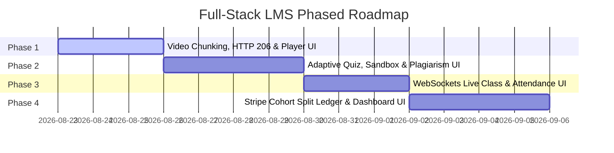

# Adaptive Learning Platform & Cohort Split Payout Ledger
## System Architecture, Technical Specification & Implementation Plan

---

## 1. Executive Summary & Objective

The **Adaptive Learning Platform** is a full-stack learning management system integrated directly into the existing MERN stack backend and Vite/React frontend. The platform enables students to enroll in time-limited course cohorts, stream videos with second-precise progress tracking, take server-driven adaptive quizzes, run code in sandboxed execution environments, participate in real-time WebSockets/WebRTC live classes, and process payments via Stripe. 

Crucially, revenue collected from cohort enrollments is automatically split between multiple instructors according to defined percentage shares and recorded in an **immutable double-entry financial ledger** supporting automated 20% refund windows, post-payout clawbacks, failed payout retries, and idempotent webhook processing.

---

## 2. Integration with Existing System & Dynamic RBAC Roles

The system seamlessly integrates with the existing authentication, JWT bearer token verification, cookie middleware, and dynamic MongoDB-backed Role-Based Access Control (RBAC) matrix.

### Role & Permission Mapping

| Role | LMS Persona | UI & System Access |
| :--- | :--- | :--- |
| **`user`** | **Student** | • Accesses enrolled courses via virtualized dashboard (`react-window`).<br>• Streams course videos via HTTP 206 range requests with second-accurate progress save.<br>• Takes adaptive quizzes; submitted code runs in sandboxed execution environment.<br>• Joins live WebSockets classes, sends chat messages, and uses "Raise Hand" Q&A queue.<br>• Enrolls in cohorts via Stripe and requests refunds within the 20% cohort timeframe. |
| **`manager`** | **Instructor / Creator** | • Creates courses, modules, and quiz questions.<br>• Uploads multi-GB video files using the **Resumable Chunk Uploader**.<br>• Defines Cohorts with price, start/end dates, and multi-instructor **split payout %**.<br>• Hosts Live WebSockets/WebRTC classes and manages the Q&A queue.<br>• Reviews student attempt histories and **code plagiarism similarity scores**.<br>• Accesses the **Instructor Financial Ledger** to inspect earnings, clawbacks, and payouts. |
| **`admin`** | **Platform Administrator** | • Complete system oversight across all courses, users, and financial records.<br>• Manages global User Roles & Dynamic RBAC Permissions matrix.<br>• Audits the platform-wide double-entry financial ledger across all cohorts.<br>• Controls failed payout retries, system-wide plagiarism flags, and enrollment overrides. |

---

## 3. Core System Modules & Technical Architecture

### Module 1: Video Handling & Resumable Player Engine
* **Resumable Chunked Uploader**: Instructors upload large video files in chunks to `/api/videos/upload-chunk`. Interrupted connections resume seamlessly without re-uploading from scratch. Completed uploads trigger background video processing.
* **HTTP 206 Range Request Streaming**: `/api/videos/:id/stream` supports range headers so students can seek through videos without downloading full files.
* **Second-Accurate Progress Tracking**: Playback position is saved automatically on `pause`, `timeupdate`, or `beforeunload` to `StudentProgress` records.

### Module 2: Adaptive Quiz Engine, Code Sandbox & Plagiarism Checker
* **Server-Driven Adaptive Engine**: 
  - Calculates topic mastery after every quiz attempt: 
    $$\text{Mastery}_{\text{new}} = (\text{Mastery}_{\text{old}} \times 0.7) + (\text{QuizScorePercentage} \times 0.3)$$
  - Server decides whether student branches to an `easier`, `medium`, or `harder` lesson path. Client logic never decides path routing.
  - Quiz retake history is preserved in `QuizSubmission` for instructor review while only the latest attempt updates mastery.
* **Sandboxed Code Execution**: Executes submitted code in an isolated Node child process with CPU/memory limits and a strict **3-second timeout** to protect workers from infinite loops.
* **Code Similarity / Plagiarism Detection**: Tokenizes submission code and calculates Jaccard similarity percentage against previous student submissions for the same assignment.

### Module 3: Real-Time WebSockets & WebRTC Live Classes
* **WebSockets Namespace (`/live-class`)**: Powered by Socket.io attached to existing HTTP server (`backend/utils/socket.js`).
* **Interactive Q&A Queue**: Real-time "Raise Hand" queue synchronized across all connected participants.
* **Reconnection-Resilient Attendance**: Logs exact `joinedAt` and `leftAt` timestamps per student per session, automatically merging reconnection intervals into a single continuous duration record.
* **WebRTC Video Transport**: WebSockets exchange WebRTC offers, answers, and ICE candidates for peer video/audio feeds.

### Module 4: Stripe Cohort Split Payments & Financial Ledger System
* **Cohort Management**: Enforces start/end dates and calculates automatic expiration (`expiresAt = startDate + durationInWeeks`).
* **Automated 20% Refund Window**: Refund API evaluates:
  $$\text{Elapsed Ratio} = \frac{\text{Current Date} - \text{Start Date}}{\text{Cohort End Date} - \text{Start Date}}$$
  If $\text{Elapsed Ratio} \le 0.20$, automated refund is processed via Stripe; otherwise denied.
* **Multi-Instructor Split Payout Engine**: Cohort revenue is distributed according to defined percentage splits (e.g. 70/30).
* **Double-Entry Financial Ledger (`LedgerTransaction`)**: Every transaction writes immutable credit/debit records (`PAYMENT`, `PAYOUT`, `REFUND`, `CLAWBACK`).
* **Post-Payout Clawbacks**: If a refund occurs after an instructor has been paid, a `CLAWBACK` record registers a negative balance against their account, deducted from future payouts.
* **Failed Payout Retry Queue**: Failed payouts are marked `FAILED` with error diagnostics and queued for manual/automated retry without losing track of money.
* **Idempotent Webhooks**: Validates signature and checks `stripeEventId` against `LedgerTransaction` records to discard duplicate or out-of-order webhooks.

### Module 5: Frontend State Management & Virtualization Architecture
* **State Management Architecture**: Uses React Context + `useReducer` pattern with custom hooks for predictable state mutations and real-time updates.
* **Virtualization**: Employs `react-window` for rendering 50+ enrolled course cards in the student dashboard without DOM degradation.
* **React 19 Concurrent Features**: Applies `useTransition` and `useDeferredValue` for smooth, non-blocking course search filtering.
* **Independent Error Boundaries**: Wraps Video Player, Quiz Engine, and Live Class Widget in separate `ErrorBoundary` components so individual component errors do not crash the entire application.

---

## 4. Full-Stack Phased Implementation Roadmap

Development is organized into **4 Full-Stack Vertical Phases**, where each phase delivers a complete end-to-end slice containing Mongoose models, backend controllers/services, REST APIs/Sockets, and Vite/React frontend UI components.



### **Phase 1: Video Handling, Resumable Chunk Uploader & HTTP 206 Course Player**
- **Backend**:
  - Schemas: [Course.js](file:///d:/InternShip/LoginSignup/backend/models/Course.js), [Video.js](file:///d:/InternShip/LoginSignup/backend/models/Video.js), [StudentProgress.js](file:///d:/InternShip/LoginSignup/backend/models/StudentProgress.js).
  - Routes & Controllers: `/api/videos/upload-chunk`, `/api/videos/complete-upload`, `/api/videos/:id/stream`, `/api/videos/progress`.
- **Frontend**:
  - [CoursePlayer.jsx](file:///d:/InternShip/LoginSignup/frontend/frontend/src/components/CoursePlayer.jsx): Progress persistence, HTTP 206 seeking, buffering indicators, course-wide progress bar.
  - [ResumableUploader.jsx](file:///d:/InternShip/LoginSignup/frontend/frontend/src/components/ResumableUploader.jsx): Resumable chunk uploader for instructors.

### **Phase 2: Server-Driven Adaptive Quiz Engine, Code Sandbox & Plagiarism Checker**
- **Backend**:
  - Schemas: [Quiz.js](file:///d:/InternShip/LoginSignup/backend/models/Quiz.js), [QuizSubmission.js](file:///d:/InternShip/LoginSignup/backend/models/QuizSubmission.js), [CodeSubmission.js](file:///d:/InternShip/LoginSignup/backend/models/CodeSubmission.js).
  - Services: `adaptiveEngine.js` (mastery scoring & path routing), `codeRunner.js` (sandboxed process with 3s timeout), `plagiarismChecker.js` (token similarity).
- **Frontend**:
  - [AdaptiveQuizEngine.jsx](file:///d:/InternShip/LoginSignup/frontend/frontend/src/components/AdaptiveQuizEngine.jsx): Dynamic path branching, visual answer breakdown, syntax-highlighted code editor.

### **Phase 3: WebSockets & WebRTC Live Classes**
- **Backend**:
  - Schema: [LiveSession.js](file:///d:/InternShip/LoginSignup/backend/models/LiveSession.js).
  - Controller/Socket: `liveClassSocket.js` (room chat, Q&A queue, WebRTC signaling, merged attendance duration tracking).
- **Frontend**:
  - [LiveClassWidget.jsx](file:///d:/InternShip/LoginSignup/frontend/frontend/src/components/LiveClassWidget.jsx): Real-time video grid, chat drawer, Raise Hand Q&A queue, live attendance list.

### **Phase 4: Cohort Split Payments, Ledger Engine, Dashboard & App Integration**
- **Backend**:
  - Schemas: [Cohort.js](file:///d:/InternShip/LoginSignup/backend/models/Cohort.js), [Enrollment.js](file:///d:/InternShip/LoginSignup/backend/models/Enrollment.js), [LedgerTransaction.js](file:///d:/InternShip/LoginSignup/backend/models/LedgerTransaction.js).
  - Services & Handlers: Stripe checkout, 20% refund window validator, multi-instructor split calculator, double-entry financial ledger service (`ledgerService.js`), idempotent webhook controller (`webhookController.js`).
- **Frontend**:
  - [CourseDashboard.jsx](file:///d:/InternShip/LoginSignup/frontend/frontend/src/pages/CourseDashboard.jsx): Virtualized dashboard via `react-window` and non-blocking `useTransition` search.
  - [CheckoutCohortModal.jsx](file:///d:/InternShip/LoginSignup/frontend/frontend/src/components/CheckoutCohortModal.jsx): Cohort enrollment & refund window UI.
  - [InstructorLedgerView.jsx](file:///d:/InternShip/LoginSignup/frontend/frontend/src/components/InstructorLedgerView.jsx): Financial ledger breakdown, split transaction history, clawback status, payout retry controls.
  - [ErrorBoundary.jsx](file:///d:/InternShip/LoginSignup/frontend/frontend/src/components/ErrorBoundary.jsx): Independent Error Boundary wrappers.

---

## 5. Database Schema Specifications

### `Course`
```javascript
{
  title: String,
  description: String,
  instructorId: { type: ObjectId, ref: 'User' },
  modules: [{
    title: String,
    lessons: [{
      title: String,
      type: { type: String, enum: ['video', 'quiz', 'live'] },
      videoId: { type: ObjectId, ref: 'Video' },
      quizId: { type: ObjectId, ref: 'Quiz' },
      topicTag: String,
      difficulty: { type: String, enum: ['easier', 'medium', 'harder'] }
    }]
  }],
  createdAt: Date
}
```

### `Cohort`
```javascript
{
  courseId: { type: ObjectId, ref: 'Course' },
  title: String,
  startDate: Date,
  endDate: Date,
  durationInWeeks: Number,
  price: Number,
  instructors: [{
    instructorId: { type: ObjectId, ref: 'User' },
    sharePercentage: Number // e.g. 70, 30
  }],
  status: { type: String, enum: ['active', 'completed', 'cancelled'] }
}
```

### `StudentProgress`
```javascript
{
  userId: { type: ObjectId, ref: 'User' },
  courseId: { type: ObjectId, ref: 'Course' },
  cohortId: { type: ObjectId, ref: 'Cohort' },
  lastWatchedVideoId: { type: ObjectId, ref: 'Video' },
  lastWatchedTimeSec: Number,
  completedLessons: [{ type: ObjectId }],
  topicMastery: { type: Map, of: Number } // e.g. { "javascript": 85 }
}
```

### `LedgerTransaction`
```javascript
{
  transactionId: String,
  cohortId: { type: ObjectId, ref: 'Cohort' },
  studentId: { type: ObjectId, ref: 'User' },
  instructorId: { type: ObjectId, ref: 'User' },
  type: { type: String, enum: ['PAYMENT', 'PAYOUT', 'REFUND', 'CLAWBACK'] },
  amount: Number,
  status: { type: String, enum: ['COMPLETED', 'PENDING', 'FAILED'] },
  stripeEventId: String,
  failureReason: String,
  createdAt: Date
}
```

---

## 6. Document Metadata
- **Created Date**: August 22, 2026
- **Status**: Approved for Implementation
- **Workspace Location**: `d:\InternShip\LoginSignup\LMS_SYSTEM_DOCUMENTATION.md`
